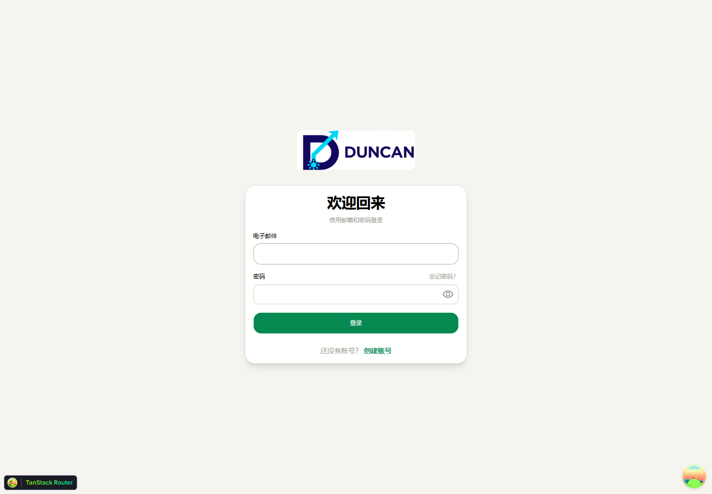
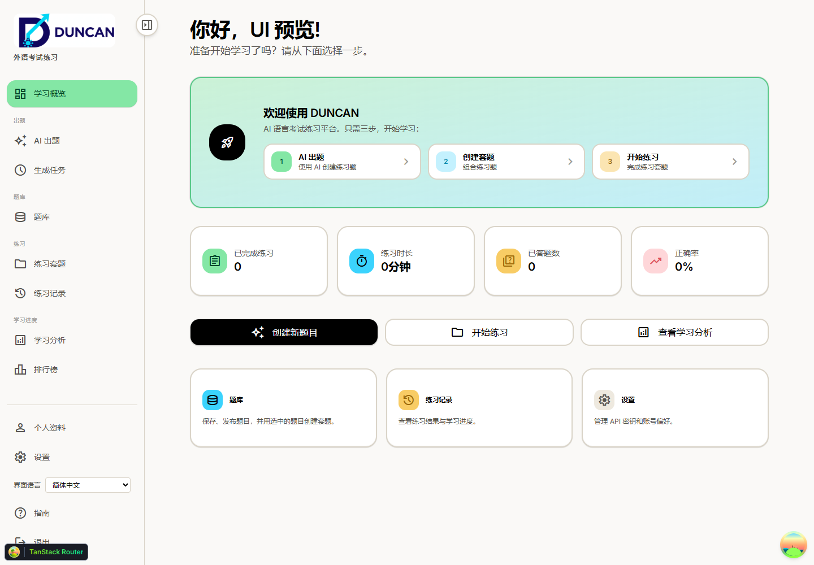

# DUNCAN 外语学习网站 · 静态演示

[返回项目首页](README.md) · [本地运行方式](README.md#本地运行与检查) · [详细验收记录](01_项目资料/04_检查与建议/验收记录.md)

这是在 GitHub 直接查看的**截图和功能介绍**，不是可操作的在线网站。项目尚未部署上线；登录、题库、AI 出题和练习需要在本地启动前后端及配套服务。

## 产品主线

选择考试和练习内容 → 从题库组卷或使用 AI 出题 → 作答 → 查看答案、历史与学习分析。界面面向中文用户，学习内容保留目标语言。

## 界面预览

以下截图来自 2026-10-24 的本地品牌与布局检查，展示当时的界面，并非近期功能的完整截图。学习概览为隔离测试会话和空数据。

### 首页

### 登录页面

### 学习概览

## 最近的代码更新

- **练习与出题：**扩展阅读、听力、口语、写作的生成和作答支持，并加入主观作答评估相关流程；实际可选范围取决于考试配置。
- **题库与组卷：**补充中文筛选文案，调整考试范围和空题库提示，改善题目选择体验。
- **账号与登录：**改善本地及局域网登录请求和失败提示；增加本地管理员开通流程。
- **品牌与界面：**替换为 DUNCAN 标志和品牌素材，保留中文界面与多语言考试目录。

这些是仓库中的代码改动，不代表已经提供完整官方考试或完成真实 AI 服务、真实邮件和所有听说流程的端到端验收。静态展示不包含实时数据，也不能注册、做题或生成内容。

## 想实际体验？

在自己的电脑上按[本地运行方式](README.md#本地运行与检查)启动项目，再访问本地前端地址。项目使用 PostgreSQL、Redis 和后端服务；AI 功能还需要相应服务配置。
